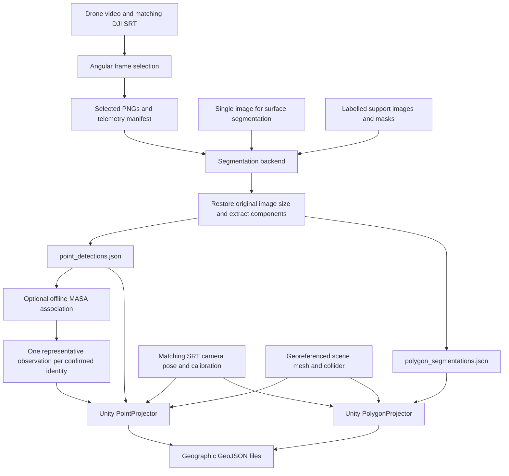

# UAV architecture and code guide

This describes the inspected implementation on 2026-11-08. UAV perception is a
Python CLI and recorded-media pipeline. Despite its filename, `uav_node.py` is
not a ROS node. Unity handles projection onto the reconstructed scene. A
continuous live UAV inference service has not yet been integrated.

## Data flow



The point route uses selected video frames. The polygon route consumes a single
image's masks and matching capture SRT. The diagram shows the raw and tracked
point alternatives; they are not intended to be imported together as duplicate
detections. API delivery is a separate downstream concern, not part of the
Python observation exporter.

## Python code structure

```text
src/triffid_uav_perception/
├── README.md
├── requirements.txt
├── requirements-sansa.txt
├── examples/supports.template.json
├── triffid_uav_perception/
│   ├── uav_node.py              # CLI commands and argument validation
│   ├── pipeline.py              # Selection, inference and export orchestration
│   ├── media.py                 # Video metadata, frame decoding, RGB image IO
│   ├── srt_metadata.py          # DJI telemetry parsing and time/frame indexing
│   ├── frame_selection.py       # Orbit/heading views and optional pitch targets
│   ├── supports.py              # Shared support bank, validation and selection
│   ├── ontology.py              # Class IDs and Point/Polygon task membership
│   ├── masks.py                 # Components, masks, boxes and raycast samples
│   ├── export.py                # Versioned, atomically written pixel JSON
│   ├── evaluation.py            # Mask and component-box metrics
│   ├── visualize.py             # Observation validation and overlays
│   ├── api_client.py            # FUTURISED media download and telemetry GETs
│   ├── models/
│   │   ├── base.py              # Common backend protocol and ClassPrediction
│   │   ├── sansa.py             # SANSA adapter
│   │   ├── dinov3_fewshot.py    # FoRIS, INSID3 and FROST adapters
│   │   ├── dino_variants.py     # RSRM and FSSDINO adapters
│   │   └── fss_sam3.py          # FSS-SAM3 visual or text+visual adapter
│   └── tracking/
│       ├── masa.py              # Adapter reusing the existing MASA engine
│       ├── session.py           # Offline association, confirmation, unique export
│       └── visualize.py         # Track overlays and preview video
└── tests/                      # Selection, masks, supports, models and tracking

scripts/
├── run_evaluation_suite.py      # Sequential isolated jobs, status, logs, runtime freeze
├── benchmark_uav_holdout.py     # Frozen holdout comparison
├── run_uav_holdout.sh           # Model-specific runtime selection
├── run_uav_sansa_test.py        # Selected-frame SANSA/FSS-SAM3 runner
├── run_uav_fss_sam3_test.sh     # Prepared FSS-SAM3 runtime wrapper
├── run_uav_polygon_test.py      # Polygon inference runner
└── run_uav_tracking.sh          # Prepared MASA tracking runtime
```

`configs/uav_pui.json` records the PUI support/split context. Evaluation settings
also live in `configs/evaluation_suite.json`. Model weights and vendor sources
are external assets; support annotations are under `uav_supports/PUI`, selected
media and evaluation outputs are stored separately.

## What each stage does

1. **Select views.** Read the video's metadata and DJI SRT, then choose views by
   orbit bearing or camera heading, optionally constrained by pitch. The default
   is eight views. Export PNGs plus `selected_frames.json`. Reusing that manifest
   avoids decoding or choosing a different set of frames for each model.
2. **Prepare the model.** Load the requested classes and real support image/mask
   pairs. Every backend exposes `prepare`, `predict` and `metadata`. The bank
   reserves five slots for each of 38 classes: 18 Point and 20 Polygon classes.
   Reserved slots are not necessarily populated examples. The evaluated holdout
   uses a selected subset with one support per class.
3. **Infer class masks.** Produce a binary mask at the query image's original
   resolution for each requested class. Backends may also expose an uncalibrated
   probability map. Missing probability output remains null, rather than being
   converted to an invented confidence.
4. **Extract observations.** Split each mask into 8-connected components. Each
   component carries its class, bounding box, area, centroid, a foreground pixel
   suitable for raycasting, and an exact cropped row-major binary RLE mask.
   JSON coordinates use a top-left origin with x right and y down.
5. **Optionally associate points.** Run MASA on the existing detections and RGB
   frames without rerunning segmentation. Confirm identities over distinct
   frames, keep all tracked sightings in `tracked_points.json`, and export one
   highest-score original observation per confirmed identity in a separate
   `point_detections.json`. Where unscored proposals are explicitly allowed, the
   representative is the first observation and exported scores remain null.
6. **Project in Unity.** Reconstruct the capture camera from the matching SRT
   and calibration. Cast point samples or polygon outer-contour vertices onto
   the map mesh collider, then convert valid surface hits to geographic
   coordinates. Missed rays are recorded rather than assigned a guessed map
   location. Export Point/Polygon GeoJSON files.

## Unity code boundary

The inspected projection project is
`/mnt/d/UnityProjects/UnityGaussianSplattingAutoWatcher/projects/GaussianExample`.
It is separate from the AR application in `/mnt/d/Unity-AR-TRIFFID`.

| Path below the projection project's `Assets` | Responsibility |
|---|---|
| `Scripts/Runtime/Camera/SrtDroneRaycastPlayer*.cs` | SRT camera pose, calibration and shared projection operations |
| `Scripts/Runtime/Mapping/MeshPathJsonLoader.cs` | Load the scene mesh |
| `Scripts/Runtime/Mapping/MapColliderSync.cs` | Scene collider synchronization |
| `Scripts/Runtime/Projection/Common/UavObservationDocument.cs` | Parse and validate the Python observation document |
| `Scripts/Runtime/Projection/Common/UavProjector.cs` | Common projection job lifecycle, paths and GeoJSON export |
| `Scripts/Runtime/Projection/Common/UavProjectionSession.cs` | Shared surface-hit/geographic projection context |
| `Scripts/Runtime/Projection/Points/PointProjector.cs` | Project a foreground point for each point observation |
| `Scripts/Runtime/Projection/Polygons/PolygonProjector*.cs` | Project original outer contours using the matching capture SRT camera |
| `Scripts/Runtime/Projection/Common/UavMaskContours.cs` | Derive mask contours for projection |
| `Scripts/Runtime/Projection/Common/UavBasicGeoJson.cs` | Basic GeoJSON export helpers |

The AR application's `GeoJsonApiManager` and `GeoJsonSyncCoordinator` implement
their own API synchronization. UAV pixel JSON does not pass directly to the
geographic API. There is no UGV-style durable PUT/PATCH sender in this UAV
Python package.

## Current integration boundaries

- The main CLI's model argument currently selects SANSA only. FoRIS, INSID3,
  FROST, RSRM, FSSDINO and FSS-SAM3 adapters are exercised through dedicated
  runners; adding adapters has not automatically exposed them in that CLI.
- RSRM and FSSDINO evaluations use the available DINOv3-L replacement, as
  authorized; they are not native DINOv3-B checkpoint results.
- MASA IDs persist within one input-video tracking run. Deterministic UUIDs
  depend on the input document, tracker metadata and settings. There is no
  durable cross-flight identity database or map-level identity guarantee.
- `api_client.py` downloads media and reads telemetry from FUTURISED. It does
  not upload detections to the map API and is not a continuous inference loop.
- `Dockerfile.uav` prepares a SANSA environment; Compose starts a shell. It
  does not deploy every evaluation runtime or start a live inference worker.
- The recorded six-class FSS-SAM3 text+visual comparison measured roughly
  6.97 seconds per warm frame. That configuration does not yet meet the
  workstation's one-processed-frame-per-second target.

This guide was checked against source and configuration. No model evaluation,
deployment or API operation was performed to produce it.
