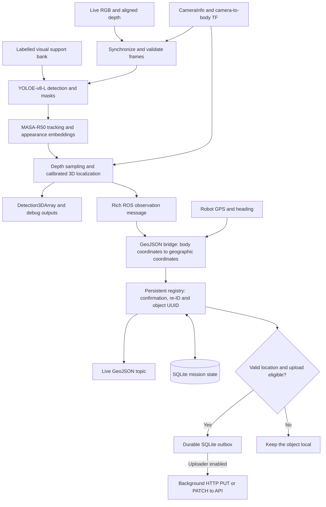

# UGV architecture and code guide

This describes the selected `ugv_live.launch.py` profile: YOLOE-v8-L, MASA-R50 and the persistent discovery registry. It retains the existing live RGB-D workflow. The legacy launch and alternative detector/tracker adapters remain available.

## Runtime architecture



There are two main ROS processes inside `triffid_ugv_live`:

| Process | Responsibility | Runtime |
|---|---|---|
| `ugv_perception_node` | Synchronization, YOLOE, MASA, body-frame 3D localization, detection and appearance publication | Prepared GPU Python runtime |
| `geojson_bridge` | Robot pose, geographic conversion, persistent UUIDs, re-ID evidence, GeoJSON and optional background delivery | ROS Python runtime |

YOLOE and MASA run together in the perception process. The bridge runs separately. The default uses the original synchronous callback scheduling. The optional `latest_frame.py` worker runs within the perception process and keeps only one pending synchronized pair; it is disabled in the current default profile.

## What happens to one frame

1. **Receive and check RGB-D.** Pair RGB and depth by timestamp; check matching optical frames, image dimensions, CameraInfo and capture-time TF. Invalid calibration/depth does not produce a fabricated 3D location.
2. **Detect with YOLOE-v8-L.** Use the frozen labelled support bank to construct visual class prompts. The current bank supplies 200 examples across 29 populated classes. Inference returns original-image boxes, object scores and instance masks. New-object acceptance is 0.35; candidates down to 0.10 remain available for track recovery. Internal 640-size preprocessing does not change the pixel grid used for localization.
3. **Associate with MASA.** Use RGB appearance plus detection boxes to keep short-term IDs and recover objects within the timestamp-aged gallery. MASA produces learned 256-dimensional appearance vectors. Physical person association is separated from the exported person-role labels.
4. **Estimate body-frame position.** Sample valid depth inside each tracked instance, back-project using camera intrinsics, then apply the recorded camera-to-body transform. Preserve distinct MASA tracks instead of merging them only because their 3D positions are nearby.
5. **Publish the existing outputs and identity evidence.** Detection3DArray and debug/segmentation outputs keep their existing interfaces. A separate bounded message carries the image box, appearance vector, body-frame position, capture timestamp and session-scoped track ID to the registry.
6. **Assign a persistent UUID.** The registry confirms candidates over observations and uses compatible appearance, class and image/world spatial evidence to recover a known UUID after track loss. Assignment is one-to-one and ambiguous matches remain uncertain. Its UUID is separate from MASA's short-term track ID.
7. **Publish GeoJSON and optionally upload.** Geographic geometry requires valid robot GPS and heading. Otherwise the object remains local and its per-frame GeoJSON geometry is null. Eligible new objects enter the durable outbox. API delivery is disabled in the current profile; when enabled under the verified server uniqueness contract, a background worker creates each UUID, then PATCHes the mapped POI for meaningful changes. Updates coalesce with a two-second per-object limit; retries retain their payload and operation key. See [API delivery](UGV_API_DELIVERY.md).

## Code structure

```text
src/triffid_ugv_perception/
├── config/
│   └── ugv_live_pui.json          # Selected models, thresholds and asset fingerprints
├── launch/
│   ├── ugv_live.launch.py        # Selected YOLOE + MASA live profile
│   └── ugv_perception.launch.py  # Legacy/parameterized launch
├── triffid_ugv_perception/
│   ├── ugv_node.py               # Perception ROS process and frame orchestration
│   ├── config.py                 # Shared parameter defaults
│   ├── ontology.py               # Stable class IDs, names and geometry types
│   ├── supports.py               # Support selection, validation and fingerprints
│   ├── bank.py                   # Support-bank CLI
│   ├── models/
│   │   ├── base.py               # Detector/segmentation contracts
│   │   ├── __init__.py           # Lazy detector factory
│   │   ├── yoloe.py              # Live YOLOE adapter and cached visual prompts
│   │   └── ...                   # Existing alternative detector adapters
│   ├── tracking/
│   │   ├── factory.py            # Tracker selection and temporal person-role evidence
│   │   ├── masa.py               # MASA association and learned appearance extraction
│   │   └── ...                   # Alternative trackers and tracking helpers
│   ├── calibration.py           # Intrinsics, rigid transforms and calibration checks
│   ├── geometry.py              # Depth sampling and geometric calculations
│   ├── pipeline.py              # Detector-independent RGB-D localization stage
│   ├── messages.py              # Standard Detection3DArray serialization
│   ├── evidence.py              # Rich observation schema and bounded validation
│   ├── debug.py                 # Segmentation labels and RGB/thermal debug output
│   ├── latest_frame.py          # Optional one-pending-frame inference worker
│   ├── geojson_bridge.py        # Second ROS process; connects pose and discovery
│   ├── position.py              # Robot GPS/heading sources and geographic conversion
│   ├── geojson.py               # Point/LineString GeoJSON formatting
│   ├── discovery/
│   │   ├── service.py           # Registry/outbox application boundary
│   │   ├── registry.py          # Confirmation, UUID assignment and persistent re-ID
│   │   ├── store.py             # Transactional SQLite state and delivery records
│   │   ├── settings.py          # Confirmation, association and capacity limits
│   │   ├── features.py          # Identity/location checks and compact feature encoding
│   │   ├── outbox.py            # Background retry worker
│   │   └── transport.py         # HTTP PUT/PATCH and acknowledgement handling
│   ├── storage.py               # Bounded images and atomic GeoJSON snapshots
│   ├── delivery.py              # Compatibility re-export of the API transport
│   ├── tracker.py               # Legacy ByteTracker; not selected in the live profile
│   └── discoveries.py           # Legacy JSON registry used by older offline runners
├── tests/                       # Model, geometry, identity and ROS integration checks
├── package.xml                  # ROS package dependencies
└── setup.py                     # Installs package, launch/config files and entry points
```

The tree abbreviates alternative adapters and support utilities; it does not imply those files were removed.

## How code responsibilities map to the pipeline

| Responsibility | Main code | Result |
|---|---|---|
| Start the selected deployment | `launch/ugv_live.launch.py`, `config/ugv_live_pui.json` | Explicit model/threshold/runtime configuration |
| Load visual supports | `supports.py`, `models/yoloe.py` | Validated per-class visual embeddings and reusable cache |
| Detect instances | `models/yoloe.py` | Class, confidence, image box and mask |
| Track and describe appearance | `tracking/masa.py`, `tracking/factory.py` | MASA ID, appearance vector and temporal role evidence |
| Compute 3D body coordinates | `calibration.py`, `geometry.py`, `pipeline.py` | Position and extent in `b2/base_link` |
| Preserve evidence across ROS nodes | `messages.py`, `evidence.py` | Standard detections plus rich identity observations |
| Convert to map coordinates | `position.py`, `geojson.py` | Geographic geometry when pose is valid |
| Keep persistent identity | `discovery/registry.py`, `discovery/store.py` | Mission-scoped UUID and recovery evidence |
| Create and update API POIs | `discovery/outbox.py`, `discovery/transport.py` | Durable PUT/PATCH request and remote acknowledgement |

## Outputs and identifiers

| Output | Meaning |
|---|---|
| `/ugv/detections/front/detections_3d` | Body-frame 3D detections with opaque session-scoped MASA track IDs |
| `/ugv/detections/front/segmentation` | Image label map, original class ID + 1; zero is background |
| `/ugv/detections/front/debug_image` | Existing visual overlay with compact displayed track numbers |
| `/ugv/detections/front/tracked_observations` | Image/body/appearance evidence for persistent identity |
| `/ugv/detections/front/geojson` | Current geographic/local observations with persistent object UUID after confirmation |
| `/ugv/detections/front/discovery_status` | Registry/outbox counts and capacity pressure |
| `/ugv/detections/front/pipeline_status` | Timing and queue counters when the optional worker is enabled |

**Class ID** identifies the semantic category. **MASA track ID** identifies the short-term track in one process session. **Object UUID** identifies the persistent discovery within the mission. **Remote API ID** is returned by the server after creation. They serve different purposes and are not interchangeable.

## Files outside the ROS package

```text
docker-compose.yml + docker-compose.ugv-live.yml  # Container and mounts
ugv_models/                                    # Vendor code, model weights and runtime
ugv_supports/PUI/                              # Labelled support bank, mounted read-only
state/PUI/yoloe_support_cache/                 # Cached visual prompts
state/PUI/live_yoloe_masa/                     # Production registry/outbox and logs
state/ugv_live_build/                          # Isolated ROS build/install
scripts/verify_yoloe_masa_live.py               # Real ROS/GPU synchronous replay check
scripts/verify_ugv_live_launch.py               # Separate-process DDS/optional-worker check
samples/YOLOE/                                 # Validation and release artifacts
```

The package separates model algorithms from geometry, identity, ROS transport and API delivery. Changing the detector does not require changing camera projection or the API sender. Changing the appearance model requires a new embedding-space fingerprint and compatible registry state.

For startup commands, asset pins, runtime requirements and measured verification results, see [the live deployment guide](UGV_LIVE_YOLOE_MASA.md). The profile uses the prepared workstation runtime; a portable clean rebuild remains separate work. Re-ID integration has been exercised, but identity accuracy still requires continuous annotated track ground truth.
