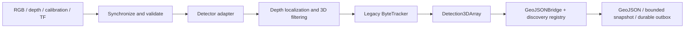

# UGV architecture, reproducibility and experiment status

Target: the current RTX 3060 system, at least one processed frame per second on the complete live pipeline after warmup. This review describes code and completed experiments, not a deployed release.

Implementation update: YOLOE-v8-L and MASA-R50 have subsequently been wired into a
dedicated live profile, preserving the old RGB-D workflow and adding appearance
transport. See [live implementation and validation](UGV_LIVE_YOLOE_MASA.md). The
architecture and remaining-work list below document the baseline before that integration.

## Current architecture

The ROS implementation receives timestamped RGB/depth, synchronizes the images, checks recorded CameraInfo and camera-to-target TF, invokes a detector, localizes accepted detections in 3D, associates them with legacy ByteTracker, and publishes Detection3DArray. GeoJSONBridge converts those observations using robot pose, maintains DiscoveryService's bounded SQLite registry/outbox, and publishes GeoJSON/status. API delivery is disabled by default and gated on valid location and the server UUID-uniqueness contract.

Main boundaries are already separate: `models/`, `supports.py`, `calibration.py`, `pipeline.py`, `tracking/`, `discovery/` and the ROS adapters. The live detector default in `config.py` is SANSA. The live tracker is constructed directly as ByteTracker in `ugv_node.py`.

The offline 65-frame comparisons instead run detector inference in each model's compatible environment, then MASA-R50 association and DiscoveryService in a compatible association environment. MASA uses learned general-instance appearance embeddings. The ROS path has not been switched to MASA. ROS Detection3DArray currently drops pixel boxes and appearance descriptors, so merely changing the tracker name will not give the downstream registry the same reacquisition evidence as the offline path. Appearance and pixel evidence need an explicit transport or co-located registry integration.

The new two-image holdout evaluation invokes detectors only. It does not measure MASA, depth localization, world-coordinate error, physical UUID deduplication or API delivery.

## Completed labelled-query experiment

Source: saved Label Studio project ROSBAG-PUI, tasks 49 and 50, annotations 38 and 39. The read-only snapshot contains 37 boxes. Two helmet boxes have no class supports, leaving **35 supported ground-truth boxes across 14 query categories**. The support bank has **200 valid examples across 29 classes**; not all support classes appear in the two queries. Pixel-identical query copies are excluded by the split builder; none were found in this snapshot. Other views of the same physical objects may remain as supports.

All eleven methods completed. COSINE's successful retry explicitly supersedes its environment-import failure; failed artifacts remain preserved. AP is COCO bbox AP50–95 after each adapter's existing confidence cutoff. Box F1 is pooled class-aware matching at IoU 0.5. Mask mIoU uses native class-mask unions within the union of saved brush pixels. Methods without masks are not assigned rectangular synthetic masks. These are different native pipelines, support policies and thresholds, not an equal-backbone/equal-shot ablation.

| Model | Bbox AP50–95 | Bbox F1 @ .5 | Annotated mask mIoU | Second-query inference |
|---|---:|---:|---:|---:|
| PET-DINO | 17.3% | 28.6% | — | 0.277 s |
| OPUS | 10.7% | 15.4% | — | 0.112 s |
| FSOD-VFM | 24.9% | 29.4% | 30.9% | 2.017 s |
| DINOv | 28.8% | 26.9% | 25.4% | 0.260 s |
| YOLOE-v8-L | 23.1% | 44.9% | 30.6% | 0.078 s |
| YOLOE-26-M | 14.9% | 28.6% | 20.5% | 0.055 s |
| YOLOE-26-L | 11.8% | 36.4% | 14.6% | 0.046 s |
| DE-ViT | 0.7% | 2.2% | — | 0.513 s |
| SINE | 5.2% | 14.3% | 5.8% | 0.340 s |
| COSINE | 10.6% | 38.3% | 20.8% | 0.444 s |
| SANSA | 32.4% | 1.9% | 45.7% | 27.898 s |

There are only two queries, so the last column is one measured second-query latency, not a stable warm mean or p95. Initialization/support preparation was 32–136 seconds in the initial sweep and is separate from inference. GPU peak allocated memory during the measured inference phase ranged approximately 0.38–4.97 GiB; that excludes reserved memory, other services and preparation peaks.

At the tested operating point, YOLOE-v8-L produced **11 true positives, 3 false positives and 24 false negatives**: precision 78.6%, recall 31.4%. It is an initial live-integration candidate because its pooled F1 and speed are useful here, but misses remain substantial. DINOv is a second candidate because its AP is higher while inference stays below one second. SANSA produced 1,556 detections, including 1,541 unmatched predictions; its higher AP does not make that operating point suitable for live use. FSOD-VFM and SANSA both exceed the one-second budget before association and projection.

Earlier original-rosbag tests processed **65 sampled frames per model** for PET-DINO, OPUS, FSOD-VFM, DINOv and YOLOE, with shared MASA-R50 tracking and export artifacts. Their warm detector means were 251.4, 119.6, 1,924.4, 183.1 and 56.5 ms respectively; warm tracker means were approximately 114–163 ms. Those runs had no labelled-query accuracy or physical identity ground truth. Their staged timings are not measured live end-to-end latency. See [the original report](PUI_MODEL_TESTS_20261106.md).

## What is reproducible now

- Frozen query/annotation snapshot and separate fixed-slot support manifest; active production support bank unchanged.
- Shared detector scorer, explicit native adapter settings, input/split/support/checkpoint hashes, source revisions, logs, per-query outputs, preserved failures and explicit successful retries.
- Isolated existing Python environments and support caches keyed by their support/configuration identities. UGV environment snapshots are explicitly labelled as captured after the initial run.
- Repeat entry point: `scripts/run_evaluation_suite.py --platform ugv --run NEW_NAME`, using `/home/oracle/miniforge3/envs/fewshot-dev/bin/python`.
- Successful CPU validation across both packages: 216 tests, including frozen-split leakage checks. The eleven UGV query-output sets passed artifact verification.

This reproduces the offline experiment on the prepared workstation. It is not yet a portable release: source is uncommitted, data/weights/vendor code/caches are ignored by Git, some runtimes depend on machine-specific paths and legacy/custom compiled libraries, and the selected detector plus MASA have not been validated together in the ROS deployment environment. A clean-machine rebuild and sustained live replay remain unproven.

Artifacts:

- `samples/evaluation/ugv/rosbag_pui_20261107_v2/<MODEL>/metrics.json`
- COSINE retry: `samples/evaluation/ugv/rosbag_pui_cosine_retry_20261108/COSINE/metrics.json`
- Runtime/input snapshot: `samples/evaluation/ugv/rosbag_pui_20261107_v2/reproducibility_snapshot.json`
- Combined report: `samples/evaluation/REPORT.md`

## Work remaining before the live release

1. **Choose and promote the detector.** Start continuous replay with YOLOE-v8-L and DINOv as candidates. Their comparison adapters currently live in `scripts/pui_comparison_detectors.py`; promote the selected adapter into the production model factory. Define required precision/recall by operational class on a separate validation set. Add helmet supports or explicitly exclude that capability from the release.
2. **Unify association and re-ID.** Wire the validated MASA path into live processing with its compatible runtime, explicit embedding-space fingerprint and required image/appearance evidence. Preserve person identity separately from changing human roles. In the current ROS callback, empty raw detections return before `tracker.update`; fix that path so loss/age state advances on empty frames as well.
3. **Measure temporal identity.** Add validated track identities to continuous rosbag segments, including occlusion, return after disappearance, adjacent same-class objects and camera motion. Then measure HOTA, IDF1, ID switches and duplicate physical UUID creation. These numbers do not exist yet.
4. **Validate the complete live pipeline.** Use timestamped RGB-D, CameraInfo, capture-time TF and fresh pose. Measure reception, drops, frame age, full processing rate/latency, GPU memory and restart/reconnect behavior. Use a bounded newest-frame worker if inference blocks ROS callbacks; the current sync queue alone does not establish a freshness guarantee. Keep network upload retries off the inference path.
5. **Freeze the release bundle.** Commit a reviewed source snapshot, pin container/library/runtime versions, include verified asset/support manifests and required compiled operations, then prove a clean rebuild and replay. Test registry/outbox persistence, storage bounds and the server's UUID uniqueness contract before enabling API sends.

Recommended three-day sequence: day 1 detector selection/integration and release configuration; day 2 continuous ROS/re-ID/localization validation; day 3 clean build, sustained load, restart recovery and delivery acceptance. The current results support selecting candidates, not declaring the release ready.
