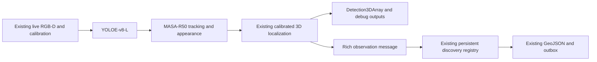

# Live UGV: YOLOE-v8-L and MASA-R50

The existing RGB-D workflow is retained. This profile replaces the detector with the evaluated YOLOE-v8-L visual-support method and replaces ByteTracker with MASA-R50. Camera topics, synchronization, recorded CameraInfo/TF localization, Detection3DArray, segmentation/debug images, robot pose conversion, GeoJSON and the durable outbox remain the same interfaces.

The required addition is a bounded appearance-evidence topic between perception and the discovery registry. A standard Detection3DArray cannot carry image boxes or appearance descriptors. MASA already supplies the learned re-ID embeddings; no separate person-only re-ID network is added.



## Run on the current workstation

```bash
docker compose -p triffid-ugv-live \
  -f docker-compose.yml -f docker-compose.ugv-live.yml up -d perception

docker logs -f triffid_ugv_live
```

Wait for `Live pipeline ready: yoloe_v8l + MASA-R50`. ROS domain is 42, inherited from the existing Compose configuration. The original broadcast RGB/depth topic names are retained. Missing/mismatched calibration or invalid depth still prevents 3D publication. No recorded frames or test identities are loaded into the production registry.

The profile is `src/triffid_ugv_perception/config/ugv_live_pui.json`; launch entry is `ugv_live.launch.py`. It pins the detector checkpoint/source revision, support-bank manifest and selected image/mask fingerprints, and MASA checkpoint/source revision/category-gate source hash. Startup rejects a changed release fingerprint. Visual prototypes are cached; no fine-tuning is performed. The bank currently supplies 200 examples across 29 classes, with unsupported classes explicitly listed in model metadata.

The current machine's prepared Python runtime is mounted read-only. YOLOE and MASA share the tested Python 3.12 / Torch 2.7 / CUDA 12.6 runtime; the GeoJSON bridge uses ROS's Python environment. The runtime depends on `/home/oracle/miniforge3` and `ugv_models/opus_env`; it is a tested workstation deployment, not a newly rebuilt self-contained model image. The ROS package builds only its own source into `state/ugv_live_build/`; vendor repositories and the existing workspace build/install are excluded from that build.

## Identity and data flow

- New detections require YOLOE confidence 0.35; MASA can recover existing tracks from candidates down to 0.10. YOLOE uses 640 inputs, NMS IoU 0.5, original-resolution masks and the evaluated normalized mean of available visual support embeddings.
- MASA retains a timestamp-aged 60-second gallery. Physical person association is separated from role evidence; citizen, first responder and military personnel remain distinct exported labels.
- Each process uses `<session_uuid>:<masa_id>` opaque track IDs. A tracker restart cannot silently reuse an old in-memory registry alias. The registry's persistent UUID is a separate identifier.
- Rich observation messages preserve image boxes, learned appearance, body-frame position/extent and original capture timestamps. Their embedding space includes the MASA checkpoint SHA256; a registry rejects a different embedding space. The bridge consumes one selected input stream, preventing duplicate updates from both rich observations and Detection3DArray.
- Already-associated instances are not merged by the old proximity-only 3D NMS. Empty frames still age MASA and reach the discovery registry. Invalid depth cannot create a fabricated 3D point.
- Reassociation keeps the existing conservative appearance, class, overlap/world-distance and one-to-one gates. This does not establish perfect identity recovery after arbitrary camera motion or long disappearances.

Mission state is under `state/PUI/live_yoloe_masa/`. The visual cache is `state/PUI/yoloe_support_cache/`. API delivery retains its existing disabled default and valid-pose/server-uniqueness gates. Verification runs use separate databases and ROS domain 142.

The live profile enables [durable PUT/PATCH delivery](UGV_API_DELIVERY.md) when
HTTP publishing is turned on: PUT a new persistent client UUID, then PATCH its
mapped API POI for meaningful changes. Updates coalesce with a two-second
per-object limit; observations flush to SQLite every second. Position changes
below one metre and confidence changes below 0.1 do not independently trigger
requests. Disappearance does not remove a POI.

## Frame scheduling

The default profile keeps the existing synchronous callback scheduling (`async_inference=false`), matching the user's request to retain the previous live workflow. An optional one-pending-frame worker can be enabled with the launch argument `async_inference:=true`. It replaces pending old frames while inference is busy and records received/replaced/stale/failed counts. It does not buffer a growing frame backlog. Its 0.9-second start interval leaves scheduling margin above the one-frame/s target.

Pipeline timing and queue counters are published on `/ugv/detections/front/pipeline_status` when the optional worker is enabled. Appearance evidence is on `/ugv/detections/front/tracked_observations`. Stable UUID results remain on `/ugv/detections/front/geojson`.

## Verification

`scripts/verify_yoloe_masa_live.py` exercised the actual GPU models, recorded scenario-1 RGB-D/calibration/static TF, actual ROS evidence transport and persistent registry over 20 sampled frames. Warm processing plus ROS/registry publication averaged **193 ms**, with **220 ms p95**; the first cold frame took approximately **2.06 s**. All stored registry objects retained appearance and image boxes. An explicit empty-frame/source-time-gap control verified MASA gallery expiry and an empty registry update. Artifact: `samples/YOLOE/live_masa_20261108_v3/verification.json`.

`scripts/verify_ugv_live_launch.py` separately checks actual launched processes using recorded images published over DDS at 8 Hz, the optional newest-frame worker, appearance transport and GeoJSON output. The initial 1.0-second scheduler produced 0.999 outputs/s; its preserved artifact is `samples/YOLOE/live_launch_20261108/verification.json`. With the 0.9-second interval, the verified output rate was **1.107 frames/s**, warm processing averaged **195 ms**, and p95 was **213 ms**. All 90 input pairs arrived; 78 pending frames were replaced, with no stale frames or processing failures. There were 12 appearance messages and 12 registry GeoJSON messages. Artifact: `samples/YOLOE/live_launch_20261108_v2/verification.json`.

CPU validation passed 230 tests across both perception packages. Additional tests cover evidence validation, bounded pending frames, worker failure recovery, preservation of separate identities during localization, same-UUID recovery after a session change and empty detections.

These tests use recorded data. A connected physical-camera run, geographic accuracy validation, long-duration operation and annotated temporal identity metrics remain separate acceptance work. The existing two-image detector accuracy results are unchanged; tracker integration does not fix missed detections.
