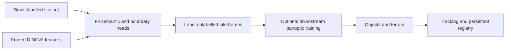

# Foundation-model few-shot perception for PUI: literature and availability review

Checked 5 November 2026. This is a broad, scoped inventory of **44 method families**, not a claim that every published few-shot paper is covered. It includes runnable candidates, adaptation alternatives, adjacent controls and approaches whose local weights are unavailable or unverified. Sources are original papers, author repositories and official model documentation. General classification, anomaly-only, medical-only, LiDAR-only and classical pre-foundation few-shot methods are outside the main inventory.

The target is 28 changeable classes, 141 current class/image supports from 25 source images, variable 1–16 examples per class, a moving ground camera at 1 frame/second, and persistent identities with creation events only for newly discovered objects. The current raw inputs are 1280×720; model resolution is a separate setting. Detector/segmentation accuracy and physical identity accuracy remain unlabelled on query frames.

**Recommendation:** benchmark OPUS first for detection, YOLOE as the speed control, DINOv for instance masks and complete-model size variants, and Label Anything/FSSDINO for explicitly multiclass semantic segmentation. FSOD-VFM and No time to train! are useful accuracy-oriented instance references with compute risk. If small target training is accepted, evaluate PrAda for semantic confusion and PASTEL for scene panoptic learning. SPINO is relevant but belongs to the target-training route.

These priorities are engineering judgments, not a measured ranking on our site. No new detector was installed or benchmarked for this review.

## Read the distinctions before comparing methods

- **N-way K-shot:** here N means simultaneous classes and K means examples per class. The user has called the requirement k-way; our current episode has 28 classes and an uneven support count. A binary foreground/background FSS method does not become efficient multiclass inference merely because its paper evaluates many classes separately.
- **Target training:** “none” means no gradient fitting on our new supports. It does not mean the released model was never trained. Frozen-backbone methods can still train task heads, prototypes or test-time adapters.
- **Output type:** boxes or instance masks provide object candidates. Semantic masks label pixels but may join touching people/trees; panoptic output separates countable things and labels terrain/stuff. Those require different identity policies.
- **Availability:** code, backbone weights, full detector weights and a working local integration are different. Published weight links below were not all downloaded or loaded. Only selected links/listings were live-checked; a local folder is not proof of successful inference.
- **Speed:** a single-target 1-shot time, cached-interaction FPS and full 28-class streaming latency are different measurements. Every untested method has unmeasured 28-class latency on our RTX 3060 and on the robot.

## Inventory

The CSV/JSON companions retain foundation models, exact class-mode caveats, adaptation requirements, release evidence, weight references, local state and priorities. The following tables are summaries. Each method name links directly to a primary source supporting its row.

### Detection and instance outputs

| Method | Output / multiclass fit | Training on our target | Availability | Assessment |
| --- | --- | --- | --- | --- |
| [OPUS](https://github.com/Megvii-Algo-Team/OpusDet) | Boxes; Joint category prototypes; Visual-G and mixed | No target fine-tuning; build reference embeddings | Code + full detector checkpoint; live HF inventory verified | Best next detector test; variable 1–16 supports and 28-class latency still need validation |
| [PET-DINO](https://github.com/fuweifuvtoo/PET_DINO) | Boxes; Joint class prototypes; visual or text modes | No target fine-tuning | Code; trained Swin-T verified locally; trained Swin-L not found | Current measured baseline; role confusion remains |
| [YOLOE](https://github.com/THU-MIG/yoloe) | Boxes + instance masks; Multiclass visual prompts; bank construction depends on runtime API | No target fine-tuning for prompting | Code + released checkpoints | Speed-oriented control; audit cross-image multi-shot aggregation before comparing |
| [DINOv](https://github.com/UX-Decoder/DINOv) | Boxes + instance masks; Category prompt banks; default 16 examples per category | No target fine-tuning with released model | Code + full Swin-T and Swin-L checkpoint links | Useful complete-model size ablation; not a DINOv2 backbone despite name |
| [FSOD-VFM](https://github.com/Intellindust-AI-Lab/FSOD-VFM) | Boxes; proposal masks internally; Multiclass support prototypes | Training-free on new target supports | Code + constituent checkpoint links | Accuracy-oriented reference; heavy multi-model pipeline and author-noted latency limitation |
| [No time to train!](https://github.com/miquel-espinosa/no-time-to-train) | Instance masks + boxes; Multiclass reference memory; custom category list documented | Training-free reference setup | Code + pretrained component instructions | Direct instance-level fit; measure proposals, matching and mask generation together |
| [DE-ViT](https://github.com/mlzxy/devit) | Boxes; Joint visual class prototypes | No target fine-tuning for exemplar inference | Code + released detector weights; used locally | Earlier run had wrong classes and false positives; larger backbone alone is not a demonstrated remedy |
| [CD-ViTO](https://github.com/lovelyqian/CDFSOD-benchmark) | Boxes; Multiclass detector; target support tuning | Yes: selected components tuned on support set | Benchmark code and DE-ViT initialization instructions | Adaptation alternative; new class bank alone does not reproduce tuned method |
| [SI-ViTO / Less Is Better](https://github.com/hyali/SI-ViTO) | Boxes; Multiclass target detector | Yes: sparse-instance few-shot adaptation | Code + DE-ViT initialization instructions | Research adaptation option; no local latency/accuracy result |
| [MQ-Det](https://github.com/YifanXu74/MQ-Det) | Boxes; Class-scalable text + visual query bank | Fine-tuning-free mode available; optional tuning | Official code and model release instructions | Relevant text/visual fusion baseline; older dependency stack and per-class query cost |
| [FT-FSOD](https://github.com/Intellindust-AI-Lab/FT-FSOD) | Boxes; Multiclass detector after target adaptation | Yes: few-shot fine-tuning | Code + initial detector weights + benchmark-specific tuned checkpoints | If training is accepted, a stronger test of target-domain adaptation than another frozen bank |
| [VisTex-OVLM](https://github.com/WitGotFlg/VisTex-OVLM) | Boxes; Multiclass visual/text queries | Published training/fine-tuning workflow; target-free use needs protocol audit | Code; sample trained checkpoint via Baidu; remaining weights pending | Potentially relevant but incomplete checkpoint coverage and custom-data integration |
| [SINE](https://github.com/aim-uofa/SINE) | Semantic and instance masks; Joint class and instance reference queries | No target fine-tuning with pretrained checkpoint | Code + released trained checkpoint; present locally | Already available; compare refreshed supports rather than treating as an untested new model |
| [COSINE](https://github.com/aim-uofa/COSINE) | Semantic and instance masks; Joint multimodal class queries | No target fine-tuning with pretrained checkpoint | Code + trained checkpoint instructions; used locally | Already tested; scores/thresholds differ from PET and need own validation |
| [SegIC](https://github.com/MengLcool/SEGIC) | Context-conditioned masks; Reference-conditioned; 28-class joint path not verified | No target fine-tuning with trained model | Research code + checkpoint instructions; separate NVIDIA model available | Evaluate research vs NVIDIA variants separately; native instance separation and class batching need audit |

### Semantic reference segmentation

| Method | Output / multiclass fit | Training on our target | Availability | Assessment |
| --- | --- | --- | --- | --- |
| [Label Anything](https://github.com/pasqualedem/LabelAnything) | Multiclass semantic masks; Explicit native N-way K-shot formulation | No target fine-tuning with released model | Code + Hugging Face pretrained model instructions | Most direct multiclass segmentation candidate; touching instances need separation for tracking |
| [FSSDINO](https://github.com/hussni0997/fssdino) | Semantic masks; Paper explicitly evaluates multiclass; 28-way implementation untested | Training-free | Code + official DINOv3 backbone dependency | Simple DINOv3 multiclass baseline; no native persistent object IDs |
| [INSID3](https://github.com/visinf/INSID3) | Target semantic / personalized masks; Released API segments a reference target; joint 28-way path unverified | Training-free | Code + official DINOv3 weights | Good backbone-size study; classwise evaluation is not evidence of efficient 28-way inference |
| [RSRM](https://github.com/Sparkling-Water/RSRM) | Target semantic masks; Released cross-domain target-class episodes | Training-free | Code + DINOv3 backbone instructions | Recent cross-domain baseline; requires multiclass adaptation and instance separation |
| [HERA](https://github.com/Zhiyuan624/HERA-CDFSS) | Target semantic masks; Target-class cross-domain episodes | Source-free test-time adaptation; not a pure cached forward | Code + DINOv3 checkpoint instructions | Check optimization cost and reset policy before 1-Hz use |
| [FROST](https://github.com/jhpark-ai/FROST) | Target semantic masks; Foreground/background target class; multiclass path unverified | Training-free | Code + official DINOv3 weights | Remote-sensing-focused evidence; ground-camera domain and class scaling untested |
| [SANSA](https://github.com/ClaudiaCuttano/SANSA) | Semantic and part masks; Generalist/strict variants; our adapter evaluates classes serially | No target fine-tuning with pretrained adapter | Code + trained adapters/generalist links; present locally | Our serial 27-class path took ~25.8 s; that result is an adapter/configuration result, not a universal model limit |
| [Matcher](https://github.com/aim-uofa/Matcher) | Reference target masks; Target-conditioned reference matching; joint 28-way path unverified | Training-free | Code + pretrained component instructions | Heavy two-model correspondence route; avoid multiplying target cost by 28 blindly |
| [GF-SAM](https://github.com/ANDYZAQ/GF-SAM) | Target semantic masks; Released target-class FSS route | Training-free | Code + pretrained component instructions | Author reports within 2 s on 2080Ti; not a 28-class 1-Hz result |
| [FSSAM](https://github.com/Sam1224/FSSAM) | Target semantic masks; Released 1/5-shot target-class variants | No target tuning with trained benchmark variant; adapters were trained upstream | Code + SAM2 and trained FSS checkpoint links | Research FSS benchmark; variable-shot bank and class scaling need engineering |
| [MARS](https://github.com/paolopertino/MARS-Multimodal-Alignment-and-Ranking-System-for-Few-Shot-Segmentation) | Mask proposal ranking / merging; Target-conditioned; inherits proposal/class route | Ranking system; adaptation depends on selected backend | Code present; component dependencies vary | Supplement to proposal methods, not an independent detector |
| [PerSAM / PerSAM-F](https://github.com/ZrrSkywalker/Personalize-SAM) | Personalized target masks; Mainly personalized target; not a ready joint category bank | PerSAM: no; PerSAM-F: small target optimization | Code + SAM backbone instructions | Useful personalization control; personal identity and category generalization differ |
| [SegGPT](https://github.com/baaivision/Painter/tree/main/SegGPT) | In-context semantic masks; Context-dependent; joint 28-way stock path unverified | No target fine-tuning with pretrained model | Code + pretrained checkpoint links | Foundational in-context baseline; instance separation and reference cost need audit |
| [FSS-SAM3](https://github.com/WongKinYiu/FSS-SAM3) | Target masks; FSOD evaluation also provided; Target-conditioned canvas; stock collage supports up to 5 images | Training-free | Code + SAM3 weights through official access | Promising few-shot control; 16 supports/class and all 28 classes exceed demonstrated stock canvas workflow |
| [Swiss DINO](https://github.com/SamsungLabs/SwissDINO) | Personal object localization / masks; One-shot personalized object search; joint category workflow unverified | No target adaptation training | Evaluation code; standalone inference explicitly unsupported in README | Interesting efficient baseline, but substantial deployment wrapper needed |

### Adaptation and panoptic learning

| Method | Output / multiclass fit | Training on our target | Availability | Assessment |
| --- | --- | --- | --- | --- |
| [SPINO](https://github.com/robot-learning-freiburg/SPINO) | Panoptic labels; trained downstream segmenter; Joint fixed label set after fitting heads | Yes: heads; optional pseudo-label student training | Code + Cityscapes/KITTI-360 archive links; Cityscapes HEAD HTTP 200 | Relevant for scene/terrain plus objects; custom 28-class taxonomy requires fitting and label preparation |
| [PASTEL](https://github.com/robot-learning-freiburg/PASTEL) | Panoptic labels; Joint fixed label set after adaptation | Yes: heads; optional self-training | Code + dataset-specific semantic/boundary checkpoint links | Follow-up to SPINO; prioritize over original if pursuing label-efficient panoptic training |
| [PrAda](https://github.com/FocoosAI/PrAda) | Semantic / instance / panoptic in paper; Joint learned class prototypes; custom semantic route documented | Yes: class prototypes and scalar alpha | Full code now released; base FC-CLIP and prototype instructions | Directly targets domain misclassification; adaptation required and custom instance path needs audit |
| [Domain-RAG](https://github.com/LiYu0524/Domain-RAG) | Synthetic support-domain training data; Inherited from detector trained on generated data | Yes: generate data and train detector | Code + component/model preparation instructions | Optional augmentation tool, not a support-bank inference replacement |

### Adjacent controls

| Method | Output / multiclass fit | Training on our target | Availability | Assessment |
| --- | --- | --- | --- | --- |
| [OWL-ViT / OWLv2](https://huggingface.co/docs/transformers/en/model_doc/owlv2) | Boxes; Multiclass text; visual k-way bank aggregation needs adapter | No target training for stock prompting | Code + pretrained checkpoints + image-guided API | Useful image-guided control; one-shot API is not automatically our variable-shot bank |
| [Grounding DINO + SAM/SAM2](https://github.com/IDEA-Research/GroundingDINO) | Text-conditioned boxes and masks; Multiclass text prompts; no native reference bank | No for text; visual few-shot requires another component | Open detector and segmentation weights | Strong text/mask baseline; not by itself a visual few-shot method |
| [SAM3 native](https://github.com/facebookresearch/sam3) | Concept instance masks and video tracks; Text/exemplar concepts; 28-way reference-bank batching not verified | No for stock concept prompts | Code + checkpoints via official access process | Concept segmentation and tracking useful; cross-image bank handling differs from PET |
| [SAMWISE](https://github.com/ClaudiaCuttano/SAMWISE) | Text-driven video object masks; Referring-video target; not a native visual class bank | No target tuning with released trained model | Code and model instructions | Temporal alternative; continuous-video behavior is not validated at 1 Hz |
| [Rex-Omni](https://github.com/IDEA-Research/Rex-Omni) | Language-conditioned boxes / points; Text/instruction-driven; visual k-way support bank unverified | No for released prompting; custom fine-tuning optional | Code + released weights / AWQ variant | Autoregressive latency and bank semantics make it a weaker first fit |

### Restricted or unverified releases

| Method | Output / multiclass fit | Training on our target | Availability | Assessment |
| --- | --- | --- | --- | --- |
| [T-Rex2](https://github.com/IDEA-Research/T-Rex) | Boxes; Generic multiclass visual and mixed protocols | No target training through service | Official public repository is API client; local full weights not verified | Does not meet current offline preference without a verified local release |
| [DINO-X](https://github.com/IDEA-Research/DINO-X-API) | Boxes; understanding tasks; Service supports text/visual prompts | No target training through service | Official API client; local full weights not verified | External API dependency conflicts with current local evaluation |
| [CP-DETR](https://arxiv.org/abs/2412.09799) | Boxes; Paper supports universal prompted detection | Would need its trained released model | Paper found; complete public checkpoint not verified | Keep in literature; do not schedule a local benchmark without weights |
| [DETR-ViP](https://github.com/MIV-XJTU/DETR-ViP) | Boxes; Visual-generic and interactive modes | Needs complete trained model; otherwise pretraining | Code available; README explicitly withholds pretrained detector weights | Cannot treat backbone downloads as a runnable trained detector |
| [T-Rex-Omni](https://arxiv.org/abs/2511.08997) | Boxes with positive/negative visual cues; Paper generic prompting; stock local workflow unverified | Requires compatible trained model | Paper verified; full local code/weights not verified in this review | Distinct from IDEA Rex-Omni; negative supports are an interesting future control |

## SPINO: what it would mean for our system

[SPINO, ICRA 2024](https://arxiv.org/abs/2309.10726), uses frozen DINOv2 features with small semantic and boundary heads. Its experiments use ten annotated images to obtain panoptic pseudo-labels. That is a small dataset-training setting, rather than ten support images per requested class at inference.

The [official workflow](https://github.com/robot-learning-freiburg/SPINO) fits the heads, generates labels for unlabelled images, and can train a downstream panoptic model. Dataset-specific Cityscapes and KITTI-360 head checkpoints are published; the Cityscapes archive returned HTTP 200 in this review. Those label sets do not cover our custom taxonomy, so their existence does not remove the need to fit our class heads.

For our application, the main attraction is a joint scene representation: separate people/vehicles while labelling road, grass and other terrain. The cost is preparing suitable semantic/instance supervision, fitting the target classes, and repeating adaptation when the taxonomy changes. Our 141 bank entries are class/image supports from 25 images; they are not automatically 141 dense panoptic training images. Audit missing classes/pixels and instance boundaries. Ignore unlabelled regions rather than declaring every unmarked object background.

The ten-image result does not prove ten arbitrary PUI frames cover 28 classes or separate civilian/responder roles. We should retain rare-class supports, hold out labelled query frames, and evaluate the fixed target label set. This is an adaptation project, not an immediate replacement within the current support-only adapter.

The authors' [PASTEL follow-up](https://github.com/robot-learning-freiburg/PASTEL) adds normalized-cut fusion and selected unlabelled-image self-training, and publishes dataset-specific head weights. If target training is accepted, I would investigate it alongside or ahead of the original SPINO. Panoptic fusion runtime still needs measurement; neither method supplies persistent physical IDs for our API policy.

## Shortlist and reasoning

| Route | First experiment | Reason | Main unresolved question |
| --- | --- | --- | --- |
| Frozen prompted detection | OPUS: Visual-G and mixed | Complete DINOv3-based detector weights; native cached category prompts and joint text/visual route | Performance with uneven, sparse supports and our role labels |
| Efficient boxes and masks | YOLOE | Strong deployment-oriented control with visual prompts | Correct multi-image aggregation and accuracy at our class granularity |
| Instance segmentation / size variants | DINOv Swin-T then Swin-L | Full trained variants and category example banks are documented | End-to-end 28-class latency and memory |
| Native multiclass semantic segmentation | Label Anything | Explicit N-way K-shot design | Separation of touching instances for tracking |
| Simple frozen DINOv3 semantic baseline | FSSDINO | Multiclass evaluation reported without a learned task head | 28-way scaling, instance extraction and false positives |
| Accuracy reference with instance outputs | FSOD-VFM or No time to train! | Prototype/reference classification plus object proposals/masks | Multi-model inference cost and proposal fragmentation |
| Lightweight target adaptation | PrAda | Optimizes only class prototypes and a fusion scalar on a frozen segmenter | Quality of mask proposals and target adaptation cost |
| Label-efficient scene learning | PASTEL / SPINO | Multi-class things plus stuff for robotic scenes | Panoptic supervision preparation, taxonomy updates and training cost |

The shortlist is not a promise that any method is more accurate on PUI. For example, [OPUS's generic visual results](https://arxiv.org/html/2608.30247v1) are stronger than the compared PET-DINO row on COCO/LVIS, but their ODinW35 scores are close. Its mixed route is especially relevant because our text-only and visual-only PET runs showed complementary successes and failures. Models were trained on different data and with different recipes, so those tables are not controlled backbone ablations.

[PrAda's code is now released](https://github.com/FocoosAI/PrAda), despite older indexed pages saying otherwise. It still requires target prototype/scalar optimization. [DETR-ViP's model zoo](https://github.com/MIV-XJTU/DETR-ViP) explicitly withholds complete pretrained detector weights. Neither a published configuration nor a generic pretrained Swin/DINO backbone is sufficient for running an untrained prompt detector.

The new DINOv3 segmentation methods offer genuinely pretrained S/B/L backbones, but a target-conditioned API is different from one joint multiclass pass. Start with one, five and all 28 classes; cache common image features where supported. Do not repeat the whole backbone per class without measuring the total. [INSID3](https://github.com/visinf/INSID3), [RSRM](https://github.com/Sparkling-Water/RSRM), [FROST](https://github.com/jhpark-ai/FROST) and [HERA](https://github.com/Zhiyuan624/HERA-CDFSS) remain research candidates rather than verified 28-way drop-ins. HERA includes test-time adaptation. FROST's strongest evidence is overhead imagery, not our ground camera.

## What is already on this PC

Read-only inspection found ThirdParty checkouts for FROST, FSS-SAM3, FSSAM, GF-SAM, INSID3, MARS, Matcher, SANSA, SEGIC, SINE, DINOv2 and DINOv3. The checkpoint directory contains entries for several SAM methods and DINOv2-L/DINOv3-L backbone files. This establishes asset presence only; no new load or inference checks were performed on those checkouts during this survey.

Existing project evidence remains useful:

- PET-DINO Swin-T, all 141 supports / 28 classes at 800: complete-frame mean 0.445 s and p95 0.473 s in the original BoT-SORT resolution study. See [controlled bank study](../PET_DINO_UPDATED_BANK_STUDY.md).
- The current 35% UDC gate was checked through identical cached detector frames, not a fresh end-to-end GPU timing run. See [threshold study](../UDC_THRESHOLD_035.md).
- Our serial SANSA adapter measured about 25.8 s for 27 classes, while its single-class inference was about 0.97 s. That motivates shared query encoding; it does not prove every possible SANSA implementation is equally slow. See [SANSA benchmark](../SANSA_GPU_BENCHMARK.md).
- SINE, COSINE and DE-ViT have already been integrated and tested under earlier banks/configurations. Those runs are not all matched for support identities, class set, precision, resolution or thresholds; they are not a current-bank accuracy leaderboard. See [SINE](../SINE_BASELINE.md), [COSINE](../COSINE_BASELINE.md), [DE-ViT](../DEVIT_BASELINE.md).

## Things, stuff, roles and identities

Our current taxonomy mixes countable instances (people, vehicles, cones, bags), terrain/material regions (grass, mud, dirt road), and functional roles (citizen, first responder). A detector excels at producing instance candidates but may produce arbitrary boxes for terrain. Semantic segmentation can represent terrain naturally but cannot always separate touching people. Panoptic methods address both output types, at greater supervision/integration cost.

Do not suppress all overlaps across categories. A person, boot, bag and hose may legitimately overlap. Keep the established person-role grouping as a controlled option; changing class evidence must not itself create another physical UUID. Visual examples of uniforms can help, but roles are not always identifiable from a single RGB view. Paper-level aggregate AP does not establish role-discrimination accuracy.

None of the support-bank methods guarantees that an object seen after a long robot revisit is the same physical object. Video-capable methods such as SAM3, DINOv or SAMWISE also need explicit 1-Hz reacquisition and new-object tests. Keep our persistent registry/outbox separate from detector state. Where available, align depth and robot pose to RGB capture time for spatial association of static assets, and distinguish those from moving people.

## Evaluation needed before replacing PET-DINO

1. Freeze the 28-class ontology and all 141 current support identities. Preserve the variable 1–16 shot counts; duplicated or augmented copies do not count as new independent shots. Keep support and query source frames separate and document same-site overlap.
2. Label the 65 query frames with object classes and physical instance IDs; the existing 14-frame review pack is a starting point, not a complete tracking benchmark. Evaluate terrain with masks and objects with instances. Distinguish missing annotations from verified negative regions.
3. Test a detector alone first: raw outputs and score sweeps. Scores are not calibrated equally across methods; a common 0.35 threshold is an operating-point control, not an accuracy-fair calibration. Select final thresholds on held-out labelled frames.
4. Compare joint class counts of 1, 5 and 28; support counts of 1 and all available; and a matched input-pixel budget plus each model's native setting. Record one shared query backbone pass versus classwise repeated computation.
5. Measure preparation, first-frame cost, warm median/p95/max, peak GPU memory, masks/box postprocessing, tracking/registry/rendering, and full one-frame-per-second pacing. Paper FPS on different GPUs or cached image interactions is not our deployment latency. Desktop RTX 3060 results do not establish Jetson performance.
6. With detector outputs fixed, compare UDC and BoT-SORT at matched confirmation policies. Score duplicate creation events per physical instance, ID switches, false merges, reacquisition, missed objects and time to first UUID. A lower UUID count can reflect filtering or false merges.
7. For SPINO/PASTEL/PrAda/FT-FSOD and other adapting methods, record training wall time, trainable parameters, labelled images, unlabelled data, and what must be repeated after adding a class. Keep held-out evaluation frames out of pseudo-label training unless explicitly reporting a transductive protocol.

A useful ablation order is PET Visual-G baseline → OPUS Visual-G → OPUS mixed → YOLOE visual prompts → DINOv instance masks. Run semantic alternatives separately on terrain and instance extraction. Evaluate target adaptation only as a separate budgeted route. No quantitative accuracy winner can be declared until the query labels exist.

## Coverage and release checks

The inventory combines primary-source keyword searches for foundation-model few-shot detection, reference instance segmentation, N-way semantic segmentation, panoptic few-label learning and the explicitly requested SPINO. It also checks author-linked successors and relevant local assets. Availability is current to the check date, not an immutable property. A paper-only or API-only entry is deliberately retained as a screened exclusion so it is not mistaken for a runnable replacement.

The 44 entries do not include every classical episodic few-shot model, specialized medical method, open-vocabulary text-only detector, or every benchmark competition variant. Standalone DINOv2/DINOv3, SAM and CLIP checkpoints are building blocks; arbitrary combinations are not counted as already trained methods. RF-DETR/EoMT and ordinary supervised YOLO models can be fine-tuned controls, but are not native support-bank few-shot replacements. L3PS is a relevant SPINO-family extension for LiDAR, outside this RGB-first scope.

Source links in the inventory are primary evidence for method features and release statements. Published checkpoint references outside the explicitly verified listings/HEAD check remain download/load checks to perform before installation. The companion [CSV](FM_FEWSHOT_METHODS_20261105.csv) and [JSON](FM_FEWSHOT_METHODS_20261105.json) can be filtered by adaptation, class mode, output type and readiness.
